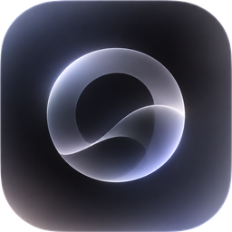
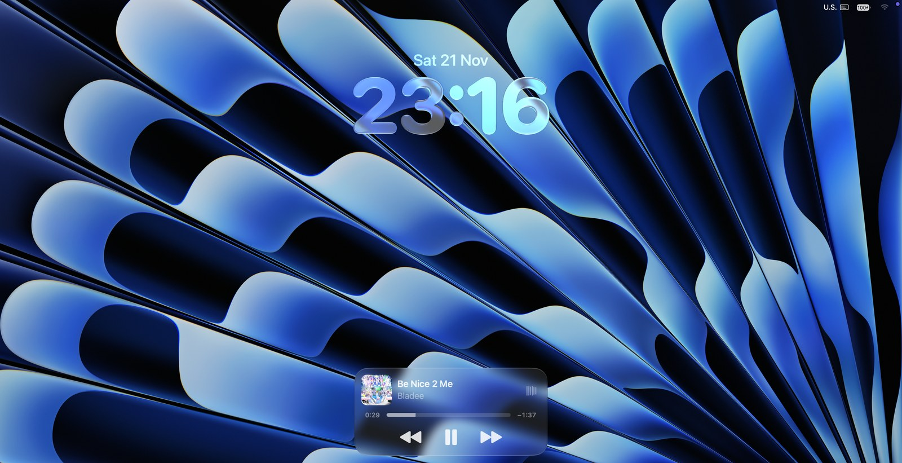
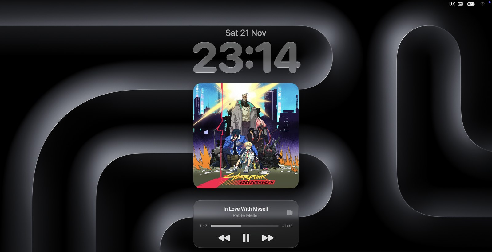

<div align="center">



# Orra

**Music and a clock for your macOS lock screen.**

A small, glassy now-playing card that sits right on top of the login window — with album art, playback controls and a live audio visualiser.


</div>

<br />

<p align="center">
  
</p>

## Download

Get **Orra.dmg** from the [latest release](https://github.com/nikolicfi/Orra/releases/latest), then:

1. Open **Orra.dmg** and drag **Orra** into **Applications**.
2. Open Orra from Applications. macOS will block it the first time. Click **Done**.
3. Go to **System Settings → Privacy & Security**.
4. Scroll down to the message about "Orra" being blocked and click **Open Anyway**.
5. Enter your password and confirm.
6. Play something in Music or Spotify and approve the Automation prompt.
7. Lock your Mac with <kbd>⌃⌘Q</kbd>.

Requires **macOS 14+**. The app isn't notarized, so steps 2–5 are only needed once.

## Modes

| Compact card | Full-screen artwork |
| :---: | :---: |
| A slim glass card with the track, progress and controls tucked under the clock. | Big artwork above the controls — the lock screen becomes a poster. |

<p align="center">
  
</p>

## Features

- **Now playing on the lock screen** — title, artist, artwork, progress and play / pause / skip.
- **Two layouts** — compact card or full-screen artwork.
- **Audio visualiser** — animates from system audio; nothing is ever recorded or stored.
- **Tunable look** — opacity, dimming and blur, to match your wallpaper.
- **Works with Music and Spotify.**
- **Lives in the menu bar** — no Dock icon, with a built-in preview so you don't have to lock your Mac to try it.

Defaults on first launch: opacity 30 %, dimming 0.1, blur 20 %.

## Build & run

Requires **macOS 14+**. Xcode 26 is recommended for the Liquid Glass look.

Open `Orra.xcodeproj` in Xcode and press <kbd>⌘R</kbd> (always open the `.xcodeproj`, not the folder), or from Terminal:

```sh
./Scripts/build.sh
open build/Orra.app
```

Then:

1. Menu bar icon → **Preview (8 s)** to test without locking.
2. Play something in Music or Spotify and approve the Automation prompt.
3. Lock your Mac with <kbd>⌃⌘Q</kbd>.

## Icons

- **App icon** — `Resources/Assets.xcassets` → `AppIcon`, or run `./Scripts/make-icons.sh my-icon-1024.png` to generate every size from one square PNG (needs macOS, uses `sips`).
- **Menu bar icon** — `Resources/Assets.xcassets` → `StatusBarIcon`: a black shape on a transparent background. It's a template image, so it adapts to light and dark menu bars.

## Good to know

- Orra uses **private SkyLight APIs** to draw above the lock screen — so it's not App Store safe and may break with macOS updates.
- Now-playing info comes from **AppleScript** (Music, Spotify). MediaRemote isn't used: it's blocked for third-party apps since macOS 15.4.
- Album artwork comes straight from Music or Spotify.
- Orra makes no network requests of its own and logs nothing. The only download is the Spotify album artwork, fetched from the URL Spotify itself provides.

<br />

<p align="center"><sub>© nikolicfi</sub></p>
